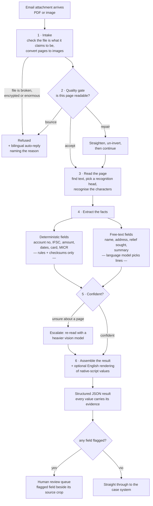

# FUNCTIONAL-SPEC.md — what the RBI complaint document service does

**Audience:** product managers, operations leads, and anyone who needs to explain this system to
someone else. **No technical background is assumed.** Every term is explained the first time it
is used, and the glossary at the end repeats all of them.

**What this document is for.** It describes what the system does, what goes in, what comes out,
what happens when a document is unreadable, when a human gets involved, what version 1
deliberately does *not* do, and how well it currently performs against its targets — with honest
PASS and MISS verdicts you can repeat in a meeting.

**Companion documents.** `docs/TUNING.md` is the engineer's guide to changing behaviour.
`docs/API.md` is the technical interface reference. `docs/eval/REPORT.md` is the full evidence
behind every number quoted here.

---

## Contents

1. [The problem, and what the system does about it](#1-the-problem-and-what-the-system-does-about-it)
2. [The flow, end to end](#2-the-flow-end-to-end)
3. [What goes in](#3-what-goes-in)
4. [What comes out](#4-what-comes-out)
5. [The quality gate: accept, repair, bounce](#5-the-quality-gate-accept-repair-bounce)
6. [Escalation and human review](#6-escalation-and-human-review)
7. [What version 1 does NOT do](#7-what-version-1-does-not-do)
8. [Headline measured performance](#8-headline-measured-performance)
9. [See it for yourself](#9-see-it-for-yourself)
10. [Glossary](#10-glossary)

---

## 1. The problem, and what the system does about it

Complaints arrive as **email attachments**. A complainant photographs a bank statement with a
phone, scans a handwritten letter, or attaches a PDF from their bank. Someone then has to read
each one and type the account number, the disputed amount, the transaction date and the rest
into a case system. That is slow, it is error-prone, and it is the same work every time.

This service does the reading. For every attachment it produces a **structured record** — a
machine-readable summary naming each fact it found and pointing at exactly where on the page it
found it. Three properties make it usable rather than merely clever:

1. **It refuses documents it cannot read**, immediately and with a reason, instead of guessing.
   The complainant gets an automatic reply asking for a better copy, in English and Hindi.
2. **It never silently corrects anything.** An account number that fails its checksum is
   published *and flagged*, so a human sees the problem rather than trusting a repaired value.
3. **Every value points back at the page.** A reviewer can see the exact crop of the original
   image that a value came from, without reading the whole document.

It handles **English, Hindi and Marathi** — the last two written in the Devanagari script.

---

## 2. The flow, end to end



**In words.** A file arrives. The system checks it is genuinely the type of file it claims to
be and converts every page to an image. Each page is scored for readability: a page that is
usable goes straight on, a page that is *fixably* crooked or inverted is repaired first, and a
page too blurred, too small or too damaged is **refused** — the complainant is told why, in two
languages, and no further processing is attempted on it.

Readable pages are then read: the system locates each line of text and recognises the characters
using whichever installed recognition head has the broadest character coverage for the page — in
practice the Devanagari head, whose dictionary also covers the full Latin alphabet, so one pass
reads both scripts (see §7.4). Facts are extracted in two
completely separate ways. **Identifiers** — account numbers, IFSC codes, transaction references,
amounts, dates, card fragments, MICR codes — are found by rules and confirmed by checksums and
lookup tables. **No language model is ever involved in those.** Free-text answers — who is
complaining, their address, what they are asking for, and which lines summarise the complaint —
are handled by a small language model whose only job is to **point at existing lines of text**.

Pages the system is unsure about are re-read by a heavier model. Finally everything is assembled
into one structured result, native-script values optionally get an advisory English rendering,
and any field that failed a check is flagged for a human.

---

## 3. What goes in

**One attachment per submission.** Three shapes, all handled:

| Input | What it is | How it is handled |
|---|---|---|
| **Digital PDF** | A PDF produced by software — a bank's statement, an emailed acknowledgement | If it carries a usable text layer, that text is used directly and character recognition is skipped entirely. This is the fastest and most accurate path |
| **Scanned PDF** | Paper put through a scanner and saved as PDF | Every page is converted to an image at 200 dots per inch and read as an image |
| **Photograph** | A phone picture of a document — JPEG or PNG | Read as an image. This is the hardest case: uneven lighting, shadows, a finger over a corner, and the page at an angle |

**Deliberate limits, and what happens when they are hit.** Each produces a specific, named
refusal rather than a crash or a silent truncation:

| Limit | Value | Refusal reason given |
|---|---|---|
| Upload size | 64 MB | rejected before the file is even read into memory |
| Pages per document | 200 | `PAGE_CAP_EXCEEDED` |
| Total image size after conversion | 500 million pixels | `PIXEL_CAP_EXCEEDED` |
| File expands more than 100× when decoded | — | `DECOMPRESSION_BOMB` |
| Password-protected PDF | — | `ENCRYPTED_PDF` |
| File type does not match its contents | — | `MIME_MISMATCH` |
| Processing time per document | 15 minutes | `WALL_CLOCK_EXCEEDED` |

**A note on where data goes.** The system runs under one of three deployment profiles:

| Profile | What it is | How data is handled |
|---|---|---|
| **`laptop`** | Development | Language-model calls go to a remote endpoint. Synthetic test data only, and that is enforced — the system **refuses to start at all** unless it is explicitly told it is processing synthetic data. There is no override flag for that check |
| **`cpu_node`** | Air-gapped, fully offline | No language model. Identifiers (account number, IFSC, amount, date, …) are still found by rules and checksums as usual; free-text fields (name, address, relief sought, …) are not extracted |
| **`gpu_node`** | Air-gapped | Two supported shapes. With an in-house OpenAI-compatible model server configured, it is a **composite provider** — the local models plus that server — and both kinds of field extract normally. With none configured, it builds the **local provider alone** and degrades the same way `cpu_node` does, to identifiers only; this is the common self-contained air-gapped shape, and it is not treated as a startup failure. Either shape, the local vision and translation models run on CUDA |

On `gpu_node`, if `HF_BASE_URL` — the address of that in-house model server — points at a host
that is not on-premises, the service refuses to start. An air-gapped profile that ends up talking
to somewhere off-premises would send complainant text off site, which is exactly what the profile
exists to prevent.

---

## 4. What comes out

One **JSON envelope** per document. JSON is a standard machine-readable text format; the envelope
is simply the container holding everything the system concluded. It has four parts:

1. **The verdict** — was the document accepted, repaired, or refused; and if refused, why.
2. **Per page** — a readability score, what was repaired, how many lines of text were found,
   the page's dominant script and language, whether the page mixes scripts (`is_code_mixed`),
   and whether that page was escalated.
3. **The document's fields** — every fact extracted, each one a small record (see below).
4. **Processing facts** — timings, token spend, warnings, and a version number.

**Script is decided per line, not per page.** Each line is labelled with the script of its own
characters, not the script of whichever head read it. A line with no script-bearing characters at
all — an account number, an amount, anything that is only digits and punctuation — casts no
script vote of its own, and inherits the page's dominant script instead. This is not cosmetic:
language identification downstream is constrained by a line's script label, so a line of English
text mislabelled Devanagari could never be identified as English. Measured on the corpus, 30 of
the 147 pages genuinely mix scripts, and `is_code_mixed` reports that directly, rather than every
page reporting a single script by construction.

### Every field carries its own evidence — what that means

Each extracted fact is not just a value. It is a record carrying: the **value exactly as it
appears on the page**, in the page's own script and never altered; an optional **advisory English
rendering** of that value together with the name of the translation engine that produced it; a
**normalised form** where one applies (a date as a standard date, an amount as a number); a
**confidence** figure; the **mechanism that produced it** — a rule, a lookup table, or the
language model; whether it **passed its validity check**; a list of **flags** naming anything a
human should look at; and finally the **evidence**: the page number, the **four corners of the
box** on that page where the value physically sits (four corners rather than a rectangle, so a
value on a tilted page is described exactly rather than approximately), and the exact character
positions within the recognised line.
That last part is what lets a reviewer be shown a cropped picture of the account number rather
than the whole document, and it is what makes every value **auditable back to the original
pixels** — the pixels of the file the complainant actually uploaded, even on a page the quality
gate straightened before reading it (see §5). The original value is immutable — the English
rendering sits beside it and never
replaces it — so nothing downstream can lose the complainant's own words.

### The two mechanisms, and why the separation is absolute

| | Deterministic fields | Free-text fields |
|---|---|---|
| **Which** | Account number, IFSC code, UTR/RRN reference, MICR code, card fragment, amounts, dates, bank name | Complainant name, address, contact, relief sought, prior complaint reference, complaint summary |
| **How** | Regular expressions, checksums, and lookup against a bank/branch master list | A small language model selects **which existing lines** answer the question |
| **Can a model touch these?** | **Never.** Not once, by design | Yes — but only to point at text, never to write it |
| **What if it fails?** | Published with `validator_passed: false` and a `VALIDATOR_FAILED` flag. **Never silently corrected** | If the proposed value does not actually appear on the page, it is **rejected outright** |

That last row is worth repeating in plain terms: the language model is not trusted to report
what a page says. Anything it proposes must be found in the page's own recognised text, allowing
for at most two character-level differences (which absorbs ordinary recognition noise). If it
cannot be found, the value is discarded and flagged. A model cannot invent an account number
into this system's output.

**The summary is not written, it is selected.** The "complaint summary" is a list of line numbers
the model chose; the system then concatenates those lines *verbatim* from the recognised text.
There is no paraphrasing step anywhere. Everything published is text that is physically on the
page.

---

## 5. The quality gate: accept, repair, bounce

Before anything is read, every page is scored between 0 and 1 for readability. Five measurements
feed that score, weighted by how much each actually predicts unreadable text:

| What is measured | Weight | In plain terms |
|---|---|---|
| Sharpness | 45% | Is it in focus? |
| Contrast | 25% | Is the ink dark enough against the paper? |
| Resolution | 20% | Is the text big enough in pixels to resolve? |
| Text coverage | 6% | Is there actually text on this page? |
| Occlusion | 4% | Is something covering part of it — a finger, a fold, a hard shadow? |

Three outcomes:

| Verdict | What happens | Complainant sees |
|---|---|---|
| **accept** | Read as-is | Nothing — it just works |
| **repair** | The page is straightened and/or un-inverted, then read | Nothing — repair is invisible and recorded in the result |
| **bounce** | **Not read at all.** No recognition, no model call, no guessed values | A bilingual automatic reply naming the reason |

**Why "repair" is a distinct outcome rather than always-on.** Straightening a page means
resampling it, which costs sharpness. Below three-quarters of a degree of tilt, the resampling
costs more clarity than the rotation recovers, so the system leaves it alone. Beyond 25 degrees
the correction can no longer be trusted and the page bounces instead.

**Evidence survives repair.** Straightening a page also changes its pixel canvas — on A4 at a 0.9
degree tilt, the corrected image comes out about 18 pixels larger than the original. Every
evidence box is mapped back through the inverse of that straightening transform before
publication, so it is always published in the coordinates of the file the complainant uploaded,
never the internal straightened copy. Skipping that step is what used to put evidence boxes on
the wrong field — visibly rotated and offset — on any page that needed repair.

### The bilingual auto-reply

A bounce is a **product outcome, not an error**. Every refusal reason has a committed, reviewed
message template in **both English and Hindi**, and the default is to send both — because a
document we could not read is also a document whose language we could not determine.

Three deliberate properties of those replies:

- **The reason code selects the wording; the wording is written, reviewed and committed.** It is
  not generated.
- **Internal detail never reaches the complainant.** Each refusal carries an engineer-facing note
  naming thresholds and stage names. That note is deliberately *not* rendered into the reply —
  piping it in is how internal paths and thresholds leak to the public.
- **A missing template is a build failure, not a blank space.** If someone adds a new refusal
  reason and forgets its message, a test fails. An unfilled placeholder can never reach a member
  of the public.

**Measured behaviour** on the 295-page test set: every page designed to be unreadable was
refused (recall 1.000), and **no clean page was ever wrongly refused** (false-bounce rate 0.000).

---

## 6. Escalation and human review

These are two different things and are often confused.

### Escalation — the machine asking for a second opinion

**Escalation is automatic and invisible to the complainant.** When a page looks unsettled, it is
re-read by a heavier vision model and the result is merged with the first reading.

What triggers it is **structural evidence, never a low confidence number from the recogniser**.
That distinction is deliberate: recognition confidence is well known to be high and wrong on
degraded text, so trusting it would escalate exactly the wrong pages. The signals and their
weights:

| Signal | Weight | Meaning |
|---|---|---|
| The two script-detection mechanisms disagree | 2.0 | On its own, enough to escalate |
| A field failed its validity check | 1.0 each, capped at 3 | Three broken fields and thirty are the same decision |
| The page scored low on quality but was not refused | 1.0 | Borderline readability |
| Handwriting detected | 0.5 | |
| The page is mostly handwritten | 0.5 | |
| Structural anomaly | 0.5 each, capped at 3 | The page does not look like what it was classified as |

A page escalates at a total of 2.0 or more.

**Two-stage delivery.** When any page escalates, the consumer does not wait. A first result is
published immediately at first-pass quality, marked *not final*, with a warning naming the pages
still in flight. The heavier model then runs and the document is **re-assembled from scratch** as
version 2, marked final. Version 2 is a fresh assembly, never a patch of version 1 — because the
heavier model exists precisely to change what the page says, and every downstream conclusion has
to be redrawn from the new text.

**The shadow sampler.** Three percent of pages that *passed* are also sent through the heavy
model anyway, purely to measure how often the router was wrong to pass them. This is how the
system measures its own blind spot rather than assuming it does not have one. A shadow-sampled
page is not an escalation and is never counted as one.

### Human review — a person looking at a flagged field

Independently of escalation, any field carrying a flag goes to a review queue. The flags are a
fixed, machine-readable vocabulary a queue can filter on:

| Flag | What a reviewer should do |
|---|---|
| `VALIDATOR_FAILED` | The value's own structure or checksum is wrong — read it off the page |
| `CHECKSUM_FAILED` | Same, specifically a checksum |
| `GROUNDING_REJECTED` | The model proposed something not actually on the page; it was discarded |
| `IFSC_NOT_IN_MASTER` | The branch code is not in the official list |
| `BANK_NAME_IFSC_DISAGREEMENT` | The bank named on the page is not the bank that owns that branch code |
| `MULTIPLE_CANDIDATES` | The page contains more than one plausible value; pick one |
| `LOW_CONFIDENCE` | Recognition was unsure |
| `HANDWRITTEN_SOURCE` | The value came from handwriting — see §7 |
| `ESCALATED_PAGE` | This page needed the heavy model |
| `TRANSLATION_UNAVAILABLE` | The English rendering was discarded to protect an identifier (see §7) |

The review interface shows the flagged field **beside the crop of the original page it came
from**, keyboard-first, so the reviewer confirms or corrects one value without reading the
document.

### Observability

Three endpoints expose what the service is doing while it runs, all read-only and all in
memory — nothing here is written to disk, and every counter resets when the process restarts.

| Endpoint | What it shows |
|---|---|
| `GET /healthz` | Status, which deployment profile is running, which models are present, whether the database is reachable |
| `GET /metrics` | Per-stage counters, plus request counters `http_requests_total`, `http_unhandled_exceptions_total` and `http_request_seconds`, in Prometheus's plain-text format |
| `GET /v1/stats` | The same counters as readable JSON: uptime, request count, client- and server-error counts, error rate, a per-route breakdown, document outcomes and bounce reasons |

Route labels in both are templates — `/v1/jobs/{job_id}`, never the resolved path — so no
document identifier ever reaches a metrics system.

**A bounce does not count as an HTTP error, on purpose.** A refused document is a product outcome
(§5), returned as an ordinary HTTP 200 response carrying a bounce envelope, so it correctly does
not raise the HTTP error rate. It is counted instead under document outcomes and bounce reasons.
Read the two together: a rising bounce count next to a flat error rate means the incoming mail
got worse, not that the service did.

---

## 7. What version 1 does NOT do

This section exists so nobody is surprised in production. Each item is a known, measured,
deliberate limit — not a defect list.

### 7.1 It does not claim accuracy on handwritten Indic text — those route to humans

Every handwriting number in the evaluation was measured on **font-rendered synthetic
handwriting**, not real handwriting. Those numbers validate the plumbing — that handwritten
pages flow through, are routed, are batched, and meet the throughput targets. **They are not
evidence the service can read a handwritten Hindi complaint letter.** Real numbers require real
handwriting samples and real complaint pages, which this build did not have access to.

Operationally: handwriting detection contributes to the escalation score, and values sourced
from handwriting carry `HANDWRITTEN_SOURCE`, so **the design routes them to people**. Treat
handwritten Indic pages as human-review work in version 1 and plan capacity accordingly.

### 7.2 It does not write summaries

There is **no abstractive summarisation** anywhere in the system. The "complaint summary" is a
set of line numbers the model selected, concatenated verbatim from the recognised text. This is
a deliberate design constraint, not a missing feature: a generated summary cannot be traced back
to a rectangle on the page, and every published value in this system must be.

If a stakeholder asks for "a two-sentence summary in the model's own words", the honest answer is
that adding it would break the provenance guarantee that makes the rest of the output
defensible.

### 7.3 Complaint categorisation is a placeholder

The component that would tag a complaint with its category — "unauthorised electronic
transaction", "ATM dispute", and so on — **exists as an interface with a keyword matcher behind
it, and refuses to run in production.** It raises an explicit error if a deployment tries to use
it as though it were real.

The reason is that the authoritative category list is the **RB-IOS taxonomy**, and this build did
not have access to it. When that list arrives, it drops into the existing interface. Until then:
**categorisation is not a version 1 capability**, and any roadmap slide showing it should say
"pending RB-IOS taxonomy".

### 7.4 Scripts outside the installed heads' coverage are the remaining weak spot

This used to be the bilingual Latin/Devanagari form — a page where every field label appears in
both scripts — because the system chose one recognition head per page by a majority vote over its
lines, and a page genuinely split between two scripts has no single right answer under a vote.
That is no longer how the choice is made. **The head for a page is now chosen by charset
coverage.** The shipped Devanagari head's output alphabet covers Devanagari *and* the full
Latin alphabet — 570 classes against the Latin head's 438, enumerated in the `rec_*_dict.txt`
files beside the weights — so it is a strict superset of the Latin head, and it is now the
default head for every page.

Measured on the corpus, on identical pixels: Devanagari text read at CER 0.90 under the Latin
head against 0.009–0.042 under the Devanagari head — the difference between unreadable and
accurate. On Latin text the two heads measure the same, CER 0.000–0.002, so the wider head costs
nothing there. A bilingual form is therefore now read correctly in a single pass, with no vote to
get wrong.

What remains is narrower, and still structural rather than a tuning gap: a page mixing two
scripts for which **no single installed head has coverage** — Devanagari and Tamil on a node with
no head covering both, for example (§7.5 lists which script models are and are not installed).
That combination still cannot be read in one pass. Rather than half-reading the page silently,
the system falls back and raises a script-disagreement signal for escalation (§6), which routes
the page to a person instead of publishing a partial result.

### 7.5 Other scope boundaries

| Not in version 1 | Why |
|---|---|
| Scripts beyond Latin and Devanagari | Tamil, Telugu and Arabic recognition models exist and are Apache-licensed; they were not fetched or tested for this phase |
| A real bank-branch master list | The system ships with a synthetic fixture. Pointing it at the real RBI list is a configuration change, not a code change — and until then, an unrecognised branch code is reported as *unverified*, not as *wrong* |
| Multi-page behaviour under load | Every test document is a single page. Multi-page handling is implemented and untested at scale |
| Throughput on the production node | Measured on a laptop-class 6-core CPU. The 16-vCPU target has a different cache hierarchy and must be re-measured — the batching setting in particular is machine-specific |

---

## 8. Headline measured performance

**Where these come from.** A 177-document evaluation run on 2026-08-08 over a synthetic test set
built for this purpose. Full evidence, including every caveat, is in `docs/eval/REPORT.md`. Two
things to hold in mind before quoting anything below:

- **The test set is synthetic.** It validates that the machinery works end to end. It is not a
  measurement of production accuracy, and its handwriting is font-rendered rather than real.
- **A held-out portion was deliberately not scored.** 118 further documents are locked away to
  test the system honestly later, because parts of it were tuned against the documents that
  *were* scored. Every number below is therefore optimistic to some degree.

> **These numbers predate the recognition fixes and have not been re-measured. Do not quote
> them as current.** Three changes landed after this run, each of which moves reading accuracy
> and therefore rows 1, 2 and §8.2:
>
> - **Line-width clamping.** Recognition crops were squeezed to 640 px, but a full-width A4 line
>   at 200 dpi normalises to 1000–1700. Five of thirteen lines on an ordinary English letter were
>   over the edge and were truncated — "We acknowledge your complaint regarding the disputed
>   transaction." decoded as "W." — at *high* confidence, because a short CTC decode is a
>   confident one. The ceiling is now 1920. This alone is expected to move the identifier
>   **recall** that row 1 identifies as the gap.
> - **Recognition-head selection by charset coverage** (§7.4), which fixed bilingual and
>   Devanagari pages read with the Latin head.
> - **Per-line script labelling from the line's own characters**, which unblocked language
>   identification on lines the head had mislabelled.
>
> Spot checks after the fixes read clean English pages at CER 0.000–0.002 against the 0.097 in
> §8.2, so the direction is clear even though the full sweep has not been re-run. §8.2's
> observation that Devanagari reads *better* than English was an artefact of the clamping bug.
> **Re-run `tools/run_corpus_eval.py` before quoting any figure in this section.**

### 8.1 The scorecard

| # | Target | Goal | **Measured** | Verdict | What a PM can say about it |
|---|---|---|---|---|---|
| 1 | Accuracy on identifiers (account, IFSC, amount, date, …) | F1 ≥ 0.97 | **0.704** | **MISS** | "When it claims an identifier it is right **82%** of the time; the problem is it only *finds* **62%** of them. The gap is reading, not judgement" |
| 2 | Accuracy on free-text fields (name, address, relief sought) | F1 ≥ 0.80 | **0.119** | **MISS** | "The language model only returns a usable answer **37%** of the time. That caps this score before answer quality is even in question — it is a model-choice problem with a known fix" |
| 3 | Every result is structurally valid | ≥ 99.5% | **1.000** (177/177) | **PASS** | "Every single result came out in the correct shape. Nothing downstream has to defend against a malformed record" |
| 4 | Identifiers silently wrong | **zero** | **0** | **PASS** | "Twelve values failed their checksum, and **all twelve were flagged**. Nothing was quietly corrected — this is the guarantee the whole design is built around" |
| 5 | Share of documents refused | 5–15% | **16.9%** | **PASS on intent** | "It refused exactly the documents built to be unreadable — every one of them — and never refused a clean page. The band does not apply because the test set was built with 17% unreadable pages on purpose" |
| 6 | Share escalated to the heavier model | ≤ 15% | **13.6%** | **PASS** | "Roughly one page in seven gets a second opinion — comfortably inside budget. (Of those, 96% look warranted, but that is measured against a stand-in rule, not a real label, so quote the 13.6% and not the 96%)" |
| 7 | How often it wrongly *passes* a page | ≤ 8% | **not measured** | **BLOCKED** | "We cannot measure this yet: the heavier model is not available on our account, so there is nothing to compare against" |
| 8 | Speed, 95th percentile | ≤ 90 s | **22.6 s** | **PASS** | "Nineteen documents in twenty finish inside 23 seconds. Note this is single-page documents — five-page ones need re-measuring" |
| 9 | Throughput on the production server | ≥ 60 pages/min | **not this machine** | **OUT OF SCOPE** | "Measured 135 pages/min on a developer laptop. The real server has different characteristics and must be re-measured on install" |

### 8.2 Reading accuracy, for context

Character Error Rate — the share of characters read wrongly. Lower is better.

| | Clean scans | All conditions including deliberately damaged |
|---|---|---|
| **English, printed** | **0.097** | 0.474 |
| **Devanagari, printed** | **0.046** | 0.518 |
| Handwriting (synthetic — see §7.1) | 0.249–0.255 | 0.65–0.81 |

**On a clean printed page the system reads Devanagari slightly better than English** and both
above 95% character accuracy. The large "all conditions" numbers come from profiles built to be
hard on purpose — heavy degradation, phone photos at an angle, deliberately unreadable pages.

### 8.3 The three things holding the scores down

Stated so nobody has to infer them:

1. **The language model returns an unusable answer 63% of the time.** It answered every one of
   the 147 requests — availability is not the problem — but only 54 answers came back in the
   required shape. This varies enormously by document type: 93% usable on a receipt, 7% on a bank
   statement. **The alternative model already benchmarked at 100%** on this measure, and switching
   is a configuration change plus one 23-minute re-run. This is the single highest-value fix
   available and it is an owner decision.

2. **A third of the free-text score is unwinnable as currently measured.** Two fields cannot
   contribute: the complaint summary *is* produced (for 47 documents) but the evaluation
   plumbing publishes it as a count rather than a scorable value, and `complainant_contact` has
   **no extractor at all** — neither the model nor a rule is ever asked for it. Together that is
   144 of 414 misses, and no amount of model tuning moves either. Both should be settled before
   any number is published as final.

3. **The remaining identifier gap is a reading problem, not a judgement problem.** Precision
   exceeds recall on every single identifier field. The system is not over-claiming; it is not
   finding things — concentrated in the degraded profiles and, at the time of this run, in the
   bilingual pages described in §7.4. That specific gap is now closed (§7.4), but this scorecard
   predates the fix and has not been re-run against it.

### 8.4 What went right, and is worth saying out loud

- **The safety guarantees held under load.** The language model went from answering 14 documents
  to answering 147, and **not one identifier field changed** — the rule that models never touch
  deterministic fields held under the only condition that could have broken it.
- **The check on invented values costs almost nothing.** Of 104 values the model proposed, only
  **3 were rejected as not being on the page**. The guarantee is real and it is nearly free.
- **The refusal path is the cheapest path.** A refused page costs 146 ms against 7.3 s for a
  fully-processed one. Refusing bad input early pays for itself on throughput before any accuracy
  argument.
- **Every result was structurally valid, and every failed checksum was flagged.** Zero exceptions
  on both, across 177 documents.

---

## 9. See it for yourself

Every number above regenerates from committed files. You do **not** need models, credentials or
network access to check the scoring — the scorer deliberately shares no code with the system it
scores, and the raw per-document results are committed.

**Step 1 — reproduce the entire scorecard from the committed results.**

```powershell
$env:PYTHONIOENCODING = "utf-8"
E:\pythonprojects\python_ocr\.venv\Scripts\python.exe tools/eval_harness.py --corpus corpus --predictions docs/eval/predictions
```

Expected output: several tables of recognition accuracy, field precision/recall, quality-gate
outcomes and latency, ending with a caveat line about synthetic handwriting and a note that the
held-out split was not scored.

> **Troubleshooting.** `UnicodeEncodeError` means step 1's `PYTHONIOENCODING` line was skipped —
> the tables contain Devanagari text. `no such file` means you are not in the repository root.

**Step 2 — look at one document's complete result, including where each value came from.**

```powershell
E:\pythonprojects\python_ocr\.venv\Scripts\python.exe -c "import json; d=json.load(open(r'docs\eval\predictions\complaint_form_en_v0_clean.json',encoding='utf-8')); print(json.dumps({k: {'value': v['value'], 'source': v['source'], 'validator_passed': v['validator_passed'], 'page': v['evidence']['page_no'], 'box': [round(x) for x in v['evidence']['bbox']]} for k, v in d['fields'].items()}, indent=1, ensure_ascii=False))"
```

Expected output: one entry per extracted field showing its value, which mechanism produced it,
whether it passed its check, and the box on the page it came from (eight numbers — four corner
points) — the evidence trail described in §4. On this document there are seven fields, six from
rules or a lookup table and one from the language model. Abridged:

```json
{
 "ifsc_code":      {"value": "SBIN0904158",     "source": "regex_validator", "validator_passed": true, "page": 1, "box": [704, 602, 896, 602, 896, 653, 704, 653]},
 "account_number": {"value": "61136570711",     "source": "regex_validator", "validator_passed": true, "page": 1, "box": [703, 682, 893, 678, 894, 731, 704, 734]},
 "prior_complaint_reference": {"value": "CMS/2025/747119", "source": "slm",  "validator_passed": null, "page": 1, "box": [708, 995, 951, 995, 951, 1042, 708, 1042]}
}
```

Note `validator_passed: null` on the language-model field: there is no checksum for a free-text
value, so the system reports "not applicable" rather than inventing a pass.

> **Troubleshooting.** A `KeyError` means you picked a document that bounced — a refused document
> has no fields at all, by design. Try a `_clean` document.

**Step 3 — read the full evidence.** `docs/eval/REPORT.md` carries every table, every caveat,
and a section on how to disagree with the method.

---

## 10. Glossary

| Term | Plain-language meaning |
|---|---|
| **Bounce** | A refusal. The document was not readable, so nothing was extracted and the complainant was told why |
| **CER** — Character Error Rate | The share of characters read wrongly. 0.05 is very good; 0.50 means half the characters are wrong |
| **Deterministic field** | A fact found by rules and checksums, never by a language model — account number, IFSC, amount, date, MICR, card fragment |
| **Devanagari** | The script Hindi and Marathi are written in |
| **Envelope** | The single structured record this service returns for one document |
| **Escalation** | Automatically re-reading a page with a heavier, slower, more capable model |
| **Evidence** | Page number, rectangle and character positions showing exactly where a value came from |
| **F1** | A single score balancing precision and recall. 1.0 is perfect |
| **Grounding gate** | The check that a value proposed by the language model actually appears on the page. If not, the value is thrown away |
| **IFSC** | The 11-character code identifying an Indian bank branch |
| **JSON** | A standard machine-readable text format |
| **LID** — Language Identification | Deciding which language a line of text is in |
| **MICR** | The 9-digit code printed along the bottom of a cheque |
| **OCR** — Optical Character Recognition | Turning a picture of text into text |
| **Precision** | Of the values the system claimed, the share that were right |
| **Provenance** | The record of where a value came from and which mechanism produced it |
| **Recall** | Of the values that were actually there, the share the system found |
| **Recognition head** | The model component that turns a cropped line of pixels into characters. A page is read by whichever installed head has the broadest coverage for it — one head can cover more than one script |
| **Repair** | Automatically straightening or un-inverting a page before reading it |
| **RB-IOS taxonomy** | The Reserve Bank's official complaint category list, which this build did not have and which categorisation is waiting on |
| **Residency gate** | The startup check that refuses to send real complainant text to a non-Indian endpoint |
| **Shadow sampling** | Sending a small share of *passed* pages through the heavy model anyway, to measure how often passing them was a mistake |
| **SLM** — Small Language Model | The language model used here only to select which existing lines answer a question. It never writes prose |
| **Schema validity** | The share of language-model answers that come back in the required structured shape. An invalid answer loses that page's free-text extraction entirely |
| **Tier 1 / Tier 2** | The fast default reader, and the heavier model used for escalated pages |
| **UTR / RRN** | Reference numbers identifying a specific bank transaction |
| **Validator** | A rule plus a checksum that confirms an identifier is structurally possible |
